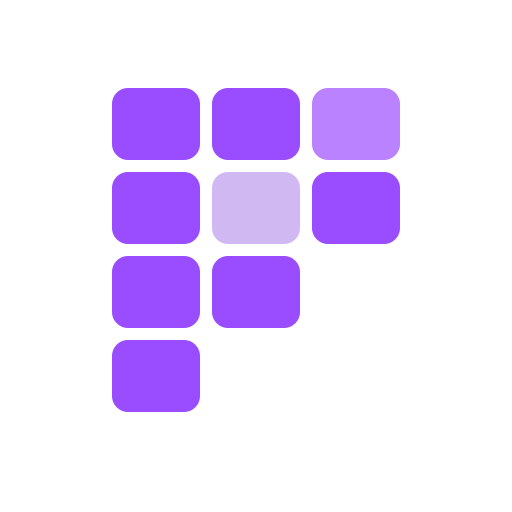
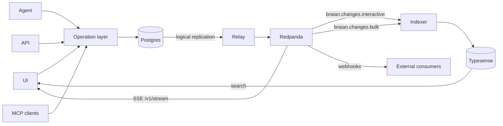

<p align="center">
  
</p>

<h1 align="center">Braian</h1>

<p align="center">Open-source, self-hosted product data, built for agents.</p>

<p align="center">
  <a href="https://github.com/GlennSvanberg/openpim/actions/workflows/ci.yml"></a>
  <a href="LICENSE"></a>
</p>

<p align="center">
  <a href="https://braian.io">braian.io</a>
  ·
  <a href="https://demo.braian.io">demo.braian.io</a>
</p>

Braian is an open-source product data system for the work a PIM usually covers. You host it yourself. It has a keyboard-first interface, and the same operations are available over the API and MCP, so an agent acts as a person in the session.

Postgres is the source of truth. A relay publishes each change to Redpanda, and search, live updates, and outbound events follow from that log.

## Features

- An agent in the session: it acts with your permissions, and every change is a proposal you can accept, review, or undo.
- A data model you define: entities, typed attributes, languages, and references. Nothing is locked to a product type.
- A headless API and MCP. The same change stream reaches open UIs over SSE and other systems over webhooks.
- Live updates in the interface.
- Search through Typesense.
- Multilingual attribute values.
- A keyboard-first UI. Ctrl+K runs the same operations as the screen.

## Architecture

Writers share one operation layer. Commits land in Postgres. Logical replication feeds the relay, which publishes interactive and bulk lanes on separate Redpanda topics so a fast edit does not wait on a bulk batch. The indexer updates Typesense. Search returns to the UI. The same topics drive SSE back to open UIs and webhooks out to other systems. The routes are `GET /v1/stream` and `/v1/webhooks`.



One binary, `braian`, runs the server roles. In development, `braian all` migrates, seeds, and runs the API, relay, and indexer together. In production, run each role as its own process.

| Piece | Path |
| --- | --- |
| Web app (TanStack Start) | `apps/web` |
| Landing page for braian.io | `apps/landing` |
| `braian` binary: `api`, `relay`, `indexer`, `all`, `seed`, `reindex`, `openapi` | `crates/server` |
| HTTP API, operations, MCP, agent, SSE, webhooks | `crates/api` |
| Logical replication relay | `crates/relay` |
| Search indexer | `crates/indexer` |
| Change topics `braian.changes.interactive` and `braian.changes.bulk` | `crates/events` |
| Typesense client | `crates/search` |
| Postgres store | `crates/store` |
| Model and validation. No I/O. Rules compile to wasm32 | `crates/model`, `crates/rules`, `crates/rules-wasm` |
| Rules package used from JavaScript | `packages/rules-wasm` |
| Synthetic catalogs and benches | `crates/synth`, `crates/bench` |
| Postgres, Redpanda, Redpanda Console, Typesense | `compose.yaml` |

## Quick start

You need Docker, Rust 1.93, Node 22, pnpm 10, and [just](https://just.systems/). The `rdkafka` crate builds with the `cmake-build` feature, so CMake and a C++ compiler must be on the path. CI installs those packages on Ubuntu.

```bash
cp .env.example .env
just up
pnpm install
just dev
```

`just up` starts Postgres, Redpanda, Redpanda Console, and Typesense. `pnpm install` is once, before Vite can start. `just dev` runs migrations, synthetic demo data, the API, the relay, the indexer, and the web app. The first run compiles Rust. Stop it with Ctrl+C.

- Web: http://127.0.0.1:3000
- API: http://127.0.0.1:8090
- Host ports, from `compose.yaml`: Postgres `5433`, Redpanda `19092`, Typesense `8108`, Redpanda Console `8080`

The demo account is created from `BRAIAN_DEMO_EMAIL` and `BRAIAN_DEMO_PASSWORD` in `.env`. See `.env.example`. Those values are not in the source tree. Without `OPENAI_API_KEY`, the Ctrl+K panel says that no model is connected. Proposals, bulk edits, and undo still work. The catalog is synthetic. Its size is `BRAIAN_SEED_COUNT`. Tests do not write that database.

On Windows, install just with `winget install --id Casey.Just` or `scoop install just`. Without it, `.\scripts\up.ps1` and `.\scripts\dev.ps1` do the same work. Visual Studio Build Tools, workload “Desktop development with C++”, supplies CMake and the compiler. A WSL2 checkout on the Linux filesystem is faster than a bind mount from `C:\`. More detail is in [docs/dev.md](docs/dev.md).

### Checks

```bash
just check
just test
```

`just demo-4` needs Redpanda. `just demo-5` needs Typesense. Both are part of `just up`. For the web app, `pnpm --dir apps/web typecheck` and `pnpm --dir apps/web test`. `node scripts/e2e.mjs` runs the browser smoke against the database `braian_e2e` and needs Postgres and Typesense from `just up`. `just --list` prints every recipe.

## Repository

```
apps/web          product UI
apps/landing      static site for braian.io
crates/           Rust workspace, one crate per component above
packages/         JavaScript package for the wasm rules
docs/             development, status, plan, measurements, OpenAPI
compose.yaml      local infrastructure
scripts/          dev.mjs, and the Windows up/dev scripts
```

## Configuration

Copy `.env.example` to `.env` and replace the placeholders. `.env` is gitignored. Names only:

| Group | Variables |
| --- | --- |
| Infrastructure | `POSTGRES_USER`, `POSTGRES_PASSWORD`, `POSTGRES_DB`, `POSTGRES_READONLY_PASSWORD`, `POSTGRES_HOST_PORT`, `DATABASE_URL`, `DATABASE_URI`, `KAFKA_BROKERS`, `TYPESENSE_URL`, `TYPESENSE_API_KEY` |
| Processes | `BRAIAN_API_ADDR`, `BRAIAN_RELAY_ADDR`, `BRAIAN_RELAY_SLOT`, `BRAIAN_RELAY_LAG_LIMIT_BYTES`, `BRAIAN_INDEXER_BATCH`, `BRAIAN_INDEXER_IMPORT_BATCH`, `BRAIAN_INDEXER_IMPORT_CONCURRENCY`, `BRAIAN_SEARCH_ALIAS`, `BRAIAN_COOKIE_SECURE`, `RUST_LOG` |
| Demo and tokens | `BRAIAN_DEV_TOKENS`, `BRAIAN_DEMO_EMAIL`, `BRAIAN_DEMO_PASSWORD`, `BRAIAN_DEMO_TOKEN`, `BRAIAN_SEED_COUNT` |
| Agent | `OPENAI_API_KEY`, `OPENAI_BASE_URL`, `BRAIAN_AGENT_MODEL`, `BRAIAN_AGENT_MOCK` |
| Tests | `BRAIAN_TEST_DATABASE_URL` |

`BRAIAN_COOKIE_SECURE` belongs on only behind HTTPS. Comments and local placeholders are in `.env.example`. Relay slot behavior for a shared Postgres is in [docs/dev.md](docs/dev.md).

## Performance

Measured figures, with hardware, data size, and the command that produced them, are in [docs/measurements/](docs/measurements/). This page does not repeat them. What is still unmeasured is called out in those notes and in [docs/status.md](docs/status.md).

## Documentation

- [docs/dev.md](docs/dev.md) — local setup, ports, commands, replication slot
- [docs/status.md](docs/status.md) — what works in the current cut
- [docs/plan.md](docs/plan.md) — phase plan for the core
- [DESIGN.md](DESIGN.md) — visual language for the app
- [docs/api/openapi.json](docs/api/openapi.json) — generated with `just openapi`
- [docs/measurements/](docs/measurements/) — measurement notes

## Contributing

See [CONTRIBUTING.md](CONTRIBUTING.md). Issues and pull requests are welcome. UI text is English. Do not commit secrets or customer data.

## Security

Report a vulnerability in private. See [SECURITY.md](SECURITY.md).

## License

[MIT](LICENSE). Copyright (c) 2026 Braian contributors.
