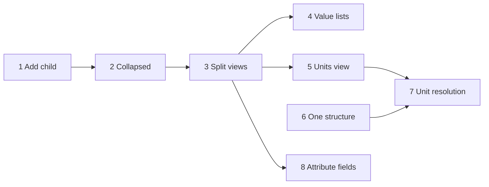
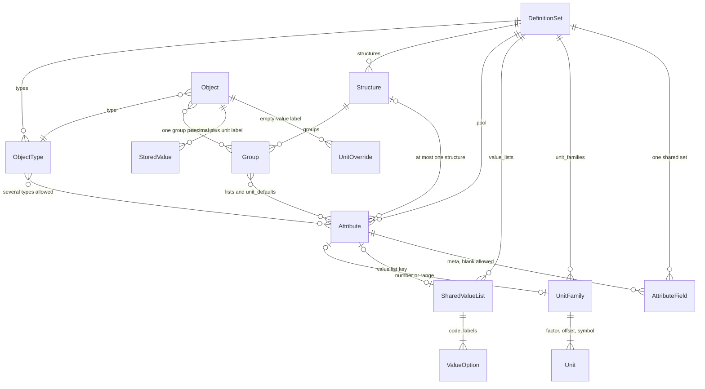

# Data model workspace

Planning only. Glenn’s notes on the Data model workspace (screenshots, 2026-10-26), checked against the code, then updated with his answers the same day. Directions, not a spec. Design source: [Braian – tes och designprinciper](https://app.notion.com/p/403212bf181a81b4b96ed5d5dd0d77a7). Two of those directions still bind this plan: no value inheritance, and rules live on the attribute.

Decisions from Glenn, 2026-10-26:

- Unit conversion is affine: `base = value * factor + offset`. Celsius and Fahrenheit are in this cut.
- An attribute may belong to only one structure. A second structure is rejected. That removes any cross-structure unit clash.
- Changing the unit on an existing number never converts the decimal. The unit is a label of what the number means. A different number is a different number.
- Attribute metadata is one shared set of fields for every attribute. Values are optional and may be left blank.

## Current state

Definitions are one versioned JSON document, not tables per concept. `definition_revisions.definitions` (`crates/store/migrations/V1__storage.sql`) holds a `DefinitionSet`: languages, `unit_families`, `value_lists`, `attributes`, `types`, `structures` (`crates/model/src/definition.rs`). Each save bumps `model_revision`, writes a batch, and appends `changes.op = 'definitions'` with an entity diff (`crates/store/src/ops.rs`, `definition_diff`). The relay publishes a small `ChangeEvent` (seq, op, no object id) on `braian.changes.interactive`. Postgres stays the source of truth.

What the model already has:

- **Object type.** No built-in article or product. `ObjectType` has singular and plural labels, one key attribute, and a list of attribute ids. The same attribute may sit on several types. The demo does this for number, name, and status.
- **Structure.** A tree of `Group`s. Applicability is `Group.attributes`, plus ancestors. `Class` remains so old revisions load; the editor writes groups (`crates/model/src/structure.rs`). The compiler still honours class lists (`crates/rules/src/compile.rs`).
- **Attribute pool.** One definition per key. A type or a group only attaches it. `same_type_and_unit` rejects a second kind or a second unit family for that key. Nothing stops the same id from being attached in two structures. The demo seed does not do that: weight and length stay in eCom, and the environment attributes stay in Environment (`crates/server/demo/definitions.json`). Inside eCom, weight is listed on both Outdoor and Timber. That is one structure, two branches, and it stays legal.
- **Value list.** `SharedValueList` (id, key, labels, options of code + labels). An attribute may point at `list: Some(key)` or keep inline `options`. The stored value is the code.
- **Unit family.** `dimension` (optional; empty means the key), `base_unit`, and units of `code` + `factor` only. `CompiledModel::normalize` multiplies by the factor (`crates/rules/src/validate.rs`, `to_base`). Compile requires a positive factor and exactly one unit with factor 1, and that unit must be the base (`crates/rules/src/compile.rs`). The object stores the entered decimal and unit (`NumberValue`). Typesense stores the base-unit float (`crates/search/src/lib.rs`, `scalar_number`).

API that exists today:

- `GET`/`PUT /v1/definitions` (JSON or YAML, `If-Match` on the revision).
- `POST`/`GET`/`PUT`/`DELETE /v1/unit-families` (`crates/api/src/definitions.rs`).
- Structure and group routes in `crates/api/src/structures.rs`.
- Attribute edits from the grid go through operations (`model.update_attribute`, `model.draft`) in `crates/model/src/model_change.rs`. `link_attribute` will attach an attribute to a second structure today.
- No `/v1/value-lists`. A shared list is only reachable by replacing the whole definition set. Choosing kind `value_list` in the grid writes `list: None` and `options: []` (`attribute_kind`).

The Data model workspace is three views of type `data_model` (`apps/web/src/templates.ts`, seeded in `crates/server/src/seed.rs`):

| View | `state.mode` | Renders |
| --- | --- | --- |
| Model | `tree` | Object types and structures in one pane (`ModelNav` in `apps/web/src/data-model.tsx`) |
| Attributes | `classes` | The attribute grid for the selection |
| Preview | `card` | Fields that would show on an object |

`class_attributes` is a different view, on each type workspace. Leave it.

### 1. Add child hides the node

`GroupList` in `apps/web/src/structure-tree.tsx` treats the draft as a replacement for the clicked row:

```270:271:apps/web/src/structure-tree.tsx
              ) : draft?.kind === 'group' && draft.structure === structure && draft.parent === node.key ? (
                <NameField label={copy.addChild} onCommit={(name) => onCreate(node.key, name)} onCancel={() => setDraft(null)} />
```

The name field takes the place of that node’s button, at the node’s depth. The node disappears, and the field sits above where a child belongs. The same swap replaces a structure title when adding a root group. `NameField` calls `focus()` on mount, then the menu closes and Radix returns focus to the `…` trigger, so the field does not keep focus.

The catalog tree (`StructureTree` in `apps/web/src/shell.tsx`) already inserts its input under the row and expands the parent. This bug is only the model tree.

### 2. The model tree starts open

`collapsed` starts as `[]`. A node is hidden only when an ancestor id is in that list, so the first paint is fully expanded. The catalog tree is the other way: `openKeys` starts from `view.state.expanded`, which is empty unless the view saved a list.

### 3–6. The other gaps

The attribute grid can set kind to value list, and can set a unit family (the column is labeled Unit, and the options are family keys). Nothing in the workspace creates a list, an option, a family, or a unit. Object detail already has a unit suffix on the number (`UnitSuffix` in `apps/web/src/panes.tsx`); that writes `unit` onto the stored value. There is no default unit on the attribute, the type, the group, or the object for a still-empty value. Attributes have no slot for custom fields.

Indexer: a definitions event has no `object_id`, so `object_ids` skips it (`crates/indexer/src/lib.rs`). `ensure_alias` creates a collection only when none exists. It does not alter a live schema and it does not rebuild documents. SSE: `/v1/stream` forwards the event, and `classifyLive` (`apps/web/src/live-refresh.ts`) treats `op: "definitions"` as `ignore`. Another session does not refetch `/v1/definitions`.

## Recommendation on units

A unit is not a value list. Keep both entities. Give them the same screen.

A value list is a closed set of codes. The object stores the code. Search facets the code. Labels are display.

A unit family is a quantity. It has a dimension, one base unit, and an affine map per member:

```
base = value * factor + offset
```

`offset` is in the base unit and defaults to 0, so a family written before this field existed still converts by multiplication. The base unit has factor 1 and offset 0. Factor stays positive, so the map can be inverted, but “exactly one unit with factor 1” is the wrong check: kelvin and Celsius can share a factor. Compile checks the named base unit instead.

The object stores the decimal as entered, plus the unit code. Search stores the base-unit float, so a filter on kilograms still matches a value entered in grams, and a filter on Celsius matches a value entered in Fahrenheit. That path is `normalize` → `scalar_number`. Folding units into `SharedValueList` would drop the factor and the offset, and it would break the split between string facets and numeric fields.

What Glenn is pointing at is the editor. Both are curated rows with a stable code and a label per language. The Units view reuses the value-list layout and adds symbol, factor, offset, and which row is the base.

`Unit` today is only `code` and `factor`. Add `offset` (default 0), `symbol` (default the code), and the same label map as `ValueOption`. `dimension` stays. Conversion stays inside one family.

Example, base Celsius: Celsius is factor 1, offset 0. Fahrenheit is factor `5/9` and offset `-160/9`, because `(F - 32) * 5/9` is `F * 5/9 + (-32 * 5/9)`. Kelvin is factor 1 and offset `273.15`.

The attribute column should stop pretending a family is a unit. The attribute stores a family and a default unit code inside that family. The object stores the unit the number was labeled with.

## One structure per attribute

An attribute id may be listed on groups, or on legacy classes, in at most one structure. `link_attribute` and `CompiledModel::compile` both reject a second structure with `attribute_in_other_structure`. The demo seed already satisfies this. A definition that does not will fail its next compile until the extra attachment is removed. Do not rewrite old revisions to detach it silently.

A type is not a structure. The same attribute may stay on several object types, and on one structure as well. There is still one stored value.

Inside that one structure the attribute may be listed on more than one group. Weight on Outdoor and on Timber is the demo, and it stays. An object sits in one group per structure, so it has one path to the root.

Applicability does not change shape:

- The object’s type contributes its attribute ids.
- The object’s group, and each ancestor, contributes the ids listed there (`Group.attributes`, and class lists already stored).
- Descendants do not receive an attribute from a sibling. Tents does not give weight to Timber.
- No number is copied onto the child. A descendant that does not list the attribute still shows it when an ancestor lists it, which is what the grid already calls inherited.

Unit defaults use that same path. They are not a second attachment. A child does not re-list the attribute in order to change the label. It sets `unit_defaults` for an attribute that already applies.

## Unit resolution

The family stays on the attribute. A type or a group must not switch it (`same_type_and_unit`). These fields are the label used when a number is still empty. They are not inherited numbers:

- `default_unit` on number and range kinds.
- `unit_defaults: BTreeMap<AttributeId, String>` on `ObjectType` and `Group`.
- `unit_overrides: BTreeMap<AttributeId, String>` on `Object`, omitted when empty.

First match wins. The function lives in `braian-rules` next to `normalize`, so the API and the wasm build agree. There is no `ambiguous_unit`. One structure means one path.

1. `unit` on the stored number or range. This is the label that was saved with the decimal. It wins for that number.
2. `object.unit_overrides` for that attribute.
3. The nearest group on the path from the object’s group to the root that sets `unit_defaults` for this attribute. That path is inside the attribute’s only structure. A setting on Tents replaces Outdoor for objects in Tents. Timber does not see Outdoor’s setting, because Outdoor is not its ancestor.
4. The type’s `unit_defaults`, when the type lists the attribute and no group on the path set one.
5. The attribute’s `default_unit`.
6. The family’s `base_unit`.

Steps 3–6 do not write a number onto the object. When someone saves a bare number, the resolved code is stamped onto that value, so later reads do not walk the tree again. The override map is the preferred label while the value is still empty.

Changing the unit on an existing number retags it. The stored decimal is not multiplied and the offset is not applied to it. 5 labeled kg, retagged as g, is 5 grams. There is no convert action. The object write goes through the normal batch, so the indexer recomputes `base = value * factor + offset` for that object and filters follow the new label. A code outside the family is `unknown_unit`.

## Attribute fields

Custom fields describe the attribute, not the object. They stay inside `DefinitionSet`. There is one set for the whole pool.

- `attribute_fields: Vec<AttributeField>` on the set. Each field has id, key, labels, and a kind of text, boolean, number, or value list (a shared list key). No `applies_to`, no unit family, and no per-language value in this cut. Every attribute shows the same fields.
- `Attribute.meta: BTreeMap<String, Json>`, sparse. A missing key and a blank value both mean unset. Nothing is required. Compile does not fail on a blank.

Edits go through the definition commit that already exists (`model.upsert_attribute_field`, `model.set_attribute_meta`), so they get a batch, a `definitions` diff, and a Redpanda event. `definition_diff` needs a new entity kind `attribute_field`. No new table. No object write.

## What stays on the wire

| Piece | Change |
| --- | --- |
| `definition_revisions` JSONB, `model_revision`, `changes` as outbox | Stays. New fields are serde defaults. `offset` defaults to 0. |
| `ChangeEvent` shape and the two topics | Stays. Definitions events still have no object id. |
| Entered number + unit in Postgres, base float in Typesense | Stays. The float uses the affine map. |
| `Group.attributes` and legacy `Class` | Stays. Both count toward the one-structure check. |
| Inline value-list `options` | Stay loadable. New lists are shared. |
| `/v1/unit-families` | Stays. The view uses it. |
| `data_model` modes `classes`, `card`, `checklist`, `impact` | Stay. |

Add `POST`/`GET`/`PUT`/`DELETE /v1/value-lists`, mirroring unit families, plus option edits on the same resource. Both write through `definitions::commit`.

SSE: when `op` is `definitions`, invalidate the `definitions` query. No new event type. Do this in the value-list PR, which is the first editor two people will use at once.

Indexer and Typesense: value-list labels, unit symbols, default units, and attribute meta do not add document fields. Field count already dominates the index (`docs/reviews/2026-10-25-architecture-review.md`). Do not index meta. A factor, offset, or base-unit change changes floats already stored; that PR calls `request_reindex` so the existing alias rebuild runs. A retag does not. It is one object write. Deleting a list code or a unit code is a breaking data change: show impact (`POST /v1/impact`) and refuse while objects still use it. That is the same rule as deleting a group that still holds objects.

## Layout

The tab is the name. No second heading inside the pane. Rows use the existing rounded `--r-lg` nodes. New view types, English titles: `object_types`, `structures`, `value_lists`, `units`. Attributes and Preview stay `data_model`.

Default Data model workspace, same three columns as now (`templates.ts` ratio 0.22 / 0.58):

```
┌──────────────────┬────────────────────────────┬──────────────────┐
│ Object types     │ Attributes                 │ Preview          │
│                  │                            │                  │
│  Product         │  Article    Articles       │  An article here │
│  Article         │                            │  gets these      │
│  Variant         │  Name   Text    —    ✓  ✓  │  fields          │
│                  │  Status Value…  —          │                  │
│ ─────────────── │  Colour Value…  —          │ ──────────────── │
│ Structures       │  Weight Number  kg         │ Value lists      │
│                  │                            │                  │
│  ▸ eCom          │  + name                    │  Colour          │
│  ▸ Environment   │                            │  Status          │
│  ▸ test          │                            │ ──────────────── │
│                  │                            │ Units            │
│                  │                            │                  │
│                  │                            │  Temperature     │
│                  │                            │  Mass            │
└──────────────────┴────────────────────────────┴──────────────────┘
```

Left and right are tab groups, so Object types, Structures, Preview, Value lists, and Units can be pulled into their own panes. The shipped layout does not add a fourth column.

- **Object types.** One rounded row per type, singular label, the current type filled. A trailing add row. Singular and plural stay at the top of Attributes, where they already are.
- **Structures.** The tree only, collapsed. Chevron on a node that has children. Add sits on the structure header, not as a section title. The draft row is a child: below the node, indented one step (`depth + 1`, about 14px, matching the current padding).
- **Value lists.** List of lists, then the options of the selected one: code, label per model language, add row at the bottom. Rounded rows, not a form.
- **Units.** Same split. A family shows dimension, and each unit shows code, symbol, label, factor, offset. The base row is marked, its factor stays 1, and its offset stays 0.
- **Attributes.** When the kind is value list, the Unit cell becomes the list picker. When the kind is number or range, it is family, then default unit. Attaching an attribute that already lives in another structure shows `attribute_in_other_structure` on the row. Meta fields open from the row menu, the same stack for every attribute, blanks allowed. Not a new pane.

`mode: "tree"` keeps rendering both lists, so a workspace saved before the split does not go blank.

## Migration

No table for lists, units, or meta. Old revisions load because the new fields default to empty and are skipped when empty. `offset` defaults to 0. `deny_unknown_fields` stays; do not rename `factor`, `list`, or `base_unit`.

Do not rewrite historical `definition_revisions`. Do not rewrite object JSON. A missing `unit_overrides` is an empty map. The one-structure rule is enforced on the next compile and on the next attach. It does not edit stored revisions. The demo seed passes.

View types are an insert (`V3__app.sql` is the pattern, `V14__class_attributes_view.sql` the latest). For the seeded Data model workspace (`…0002` in `crates/server/src/seed.rs`), add the four views and point the left tab at Object types and Structures, the right tab at Preview, Value lists, and Units. Leave the old Model view in place but off the layout, so a saved personal layout that still cites its id does not dangle. New workspaces come from `templates.ts`. The Overview checklist view is untouched.

`rules` still compiles to `wasm32-unknown-unknown`. The affine map, the one-structure check, and the new validation codes stay in that crate.

## Risks

- **Focus and the menu.** The input has to take focus after the dropdown’s close, or the bug report comes back as “it still doesn’t focus”.
- **Collapsed plus add child.** A child row under a collapsed parent is invisible. Adding a child expands that parent in the same click.
- **One structure on a catalog that already shares an attribute.** Compile starts failing for that set. The fix is to detach one side, not to pick a winner. The demo seed is clean. A future import might not be.
- **Factor 1 is no longer unique.** Kelvin and Celsius can both use factor 1. The base is the named unit with factor 1 and offset 0. A second unit with factor 1 and offset 0 is still an error.
- **Retag moves filters.** The decimal stays. The indexed base float changes because the label changed. The unit control has to read as a label, not as a conversion.
- **Factor or offset edits and the index.** Documents stay stale until reindex. `request_reindex` rebuilds the alias; it is the slot-recovery path and it is heavy. Do not call it for a label or symbol edit.
- **Schema drift.** Adding a filterable attribute still does not patch a live Typesense collection. This plan does not fix that. It also does not add fields, so the new views do not make it worse.
- **Inline options.** Attributes with inline options keep working. The grid’s list picker only offers shared lists. An attribute with inline options and no `list` shows those options as read-only until someone promotes them.

## Sequence

Sizes are scope, not calendar. S is one screen and no migration. M is a model or API change plus one view. Each PR is shippable on its own. 1 and 2 are the quick wins.



1. **Add child lands below the node.** S. `structure-tree.tsx` only. Keep the clicked row. Render the name field as the next row at `depth + 1`. Root groups land under the structure title, not in it. Expand the parent. On menu close, cancel the trigger focus and focus the input. Cover it from the data-model UI (the catalog spec in `apps/web/e2e/structure.spec.ts` is the other tree).
2. **Start collapsed.** S. Same component, after 1. Default expanded set is empty. Chevrons appear on nodes with children. Session state only; do not write `view.state`. Do not change the catalog tree.
3. **Split the Model view.** M. View types, template, seed, the workspace migration, dock glyphs in `apps/web/src/chips.tsx`. `mode: "tree"` remains the fallback. Depends on 1 and 2 so Structures ships with the fixed tree.
4. **Value lists.** M. `/v1/value-lists`, operations, the view, the attribute picker, and the SSE invalidate. Deleting an option that objects use goes through impact and is refused. Depends on 3 for the pane.
5. **Units view.** M. `offset`, symbol, and labels on `Unit`. `to_base` becomes `value * factor + offset`. The base-unit check becomes factor 1 and offset 0 on the named base. Serde default 0. The view uses `/v1/unit-families`. Factor, offset, or base changes call `request_reindex`. Depends on 3. Can share row components with 4.
6. **One structure per attribute.** M. `attribute_in_other_structure` in `link_attribute` and in compile, counting groups and legacy classes. No unit defaults yet. Can start without 3, 4, or 5. The attribute grid shows the error once 3 is in.
7. **Unit resolution.** M. `default_unit`, the two `unit_defaults` maps, `unit_overrides`, the path walk above, and the object editor. Retag only. Depends on 5 and 6. This is the PR that touches object JSON.
8. **Attribute fields.** M. One `attribute_fields` list, sparse optional `Attribute.meta`, the diff kind, the row-menu editor. Blank is valid. No index change. Depends on 3. Parallel with 4–7.

## Data model



`base = value * factor + offset`. The stored decimal is never rewritten on a retag. `StoredValue.unit` beats `UnitOverride`. That beats the nearest group on the single path, then the type, then `Attribute.default_unit`, then `UnitFamily.base_unit`. Group and type defaults never copy a number onto a child.

## Open questions

1. Should inline value-list options be promoted into shared lists automatically, or left until someone does it?
2. The catalog tree already starts collapsed. Should that stay as it is?
